I'm a software engineer in my third year of B.Tech CSE (AI/ML), graduating in 2028. My focus is AI engineering. Java is my main backend language, and I want enough depth in it to work on older systems too.

[](https://www.linkedin.com/in/rohith-rajan-v)
[](https://leetcode.com/u/TheGuywithScar/)
[](https://codolio.com/profile/TheGuywithScar)
[](https://rohithrajanv.netlify.app)

## AI and ML

### [SpeakRightAI](https://github.com/RR-1902/speakrightAI)

A pronunciation coach. Whisper transcribes what you say, CMUdict breaks the words into phonemes, and a scoring engine compares each phoneme you spoke with the expected one. You get feedback per sound, and your sessions are tracked so you can see progress. The whole app runs in Docker.

Built with FastAPI, Whisper, NLTK, React and Docker.

### [Welp.Ai](https://github.com/RR-1902/welp-ai)

A mobile interview simulator. You upload a resume and answer by voice or text. The follow-up questions come from what your resume says, and at the end you get a score and a PDF report you can keep.

Built with Flutter, Express and OpenRouter.

### [CancerDetect](https://github.com/RR-1902/cancerdetect)

A histopathology image classifier. It uses MobileNetV2 transfer learning to flag cancer in tissue images and gives a risk score through a Flask web app. It is a learning project and is not a diagnostic tool.

Built with Python and Flask.

### SANGAM

A prototype for Smart India Hackathon 2026. Complaints about one institution arrive at different offices and in different languages. SANGAM matches them, puts them on one timeline, and blocks closing a case while a linked one is still open. It works in English, Hindi and Tamil. On synthetic data the matcher reaches precision 86% and recall 83%, against an F1 of 25% for rules alone. The code is not public yet.

Built with Python.

### TEKTON

A seven-day earthquake outlook for India and its neighbours. It forecasts odds and is not an early warning system. On untouched test data it beats the long-run-rate baseline by a small margin, PR-AUC 0.151 against 0.131. The code is not public yet.

Built with Python, XGBoost and FastAPI.

## Systems

### [Aegis](https://github.com/RR-1902/aegis)

A network intrusion detection system. It captures packets, parses Ethernet, IPv4, TCP, UDP and ICMP, groups packets into flows, applies deterministic rules and scores the combined evidence. Responses are simulated only, and every security event is stored in SQLite.

Built with Python, Scapy and SQLite.

### [CampusPulse](https://github.com/RR-1902/attendance-campuspulse)

A campus management platform with separate views for admins, faculty and students. It handles sign-in with JWT, attendance workflows, analytics charts, placement notices and a complaint portal.

Built with Next.js, TypeScript, FastAPI and SQLAlchemy.

### [Co-op](https://github.com/RR-1902/Co-op)

A marketplace for cooperative workforces with five roles, built for Smart India Hackathon 2026.

Built with React, TypeScript and Supabase.

## In design

Pantheon is a mentor tool for my college tech club. I will measure its retrieval against plain keyword search and publish the results either way.

Asclepius is a Raft-replicated key-value store in Java. A chaos harness will kill nodes and cut the network while a checker confirms that no acknowledged write was lost.

## Tech stack


## GitHub activity

[](https://git.io/streak-stats)

[](https://github.com/ashutosh00710/github-readme-activity-graph)


## How I work

I compare every result with a baseline, and when mine doesn't beat it, I say so. I note which parts of a project were built with AI assistance. I call something a prototype, a pilot or production according to what it is today.

I'm also Technical Head of SlugNPlug, a student tech club.

```text
████   ███  █   █ ███ █████ █   █
█   █ █   █ █   █  █    █   █   █
████  █   █ █████  █    █   █████
█  █  █   █ █   █  █    █   █   █
█   █  ███  █   █ ███   █   █   █
```
