

  

  <a href="https://github.com/RR-1902/speakrightAI"></a>

  

  <a href="https://github.com/RR-1902/welp-ai"></a>

  <a href="https://github.com/RR-1902/cancerdetect"></a>

  

  <a href="https://github.com/RR-1902/aegis"></a>

  <a href="https://github.com/RR-1902/attendance-campuspulse"></a>

  <a href="https://github.com/RR-1902/Co-op"></a>

  

  

  

  

  

